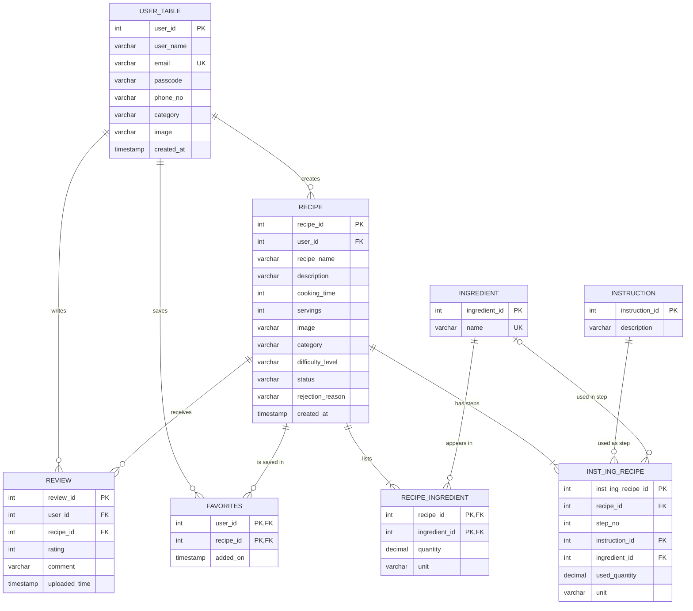

# Recipe Book: A Recipe Management System

**Project Report**

Submitted by: Ruthvi Maram
B.Tech, Data Science and Engineering, Indian Institute of Technology Palakkad

Course: [course name and code]
Instructor: [instructor name]

Repository: https://github.com/Ruthvi5/Recipe-management-system

---

## Abstract

Recipe Book is a web based recipe management system in which users publish recipes, administrators moderate them, and every visitor can search, read, rate and save the recipes that have been approved. The project was built to practise database design and server side database programming, so the PostgreSQL database carries most of the application logic: ten stored procedures, six functions, three views, nine triggers and fifteen indexes sit behind a Flask web application with separate user and admin interfaces. The schema models recipes as an ordered list of instructions, each linked to the specific ingredients and quantities it uses, and the triggers make sure that the quantities used across all steps never exceed what the recipe lists. This report describes the requirements, the entity relationship model and relational schema, the normalisation of the design, the procedural database code, the application layer, the testing that was carried out, and the limitations of the current version.

---

## 1. Introduction

Home cooks collect recipes from many places, and a shared recipe site is only useful if what it shows is accurate and of reasonable quality. Recipe Book addresses this with a simple publishing workflow. Anyone can read recipes, registered users can submit their own, and nothing appears in the public catalogue until an administrator approves it. Rejected recipes are kept so that the author can see why they were turned down.

The objectives of the project were to design a normalised relational schema for users, recipes, ingredients, instructions, reviews and favourites; to implement the core operations as stored procedures and functions so that the rules are enforced by the database regardless of which client calls it; to use triggers for validation and for automatic values such as timestamps and default status; to provide role based access for guests, registered users and administrators; and to build a working web interface on top of the database.

---

## 2. Requirements

### 2.1 Users and roles

The system has three kinds of user, stored in a single table and told apart by a `category` column.

A guest is anyone who enters an email address that is not yet registered. The system records the email with a generated name such as `Guest_48213`, so that a guest can later register with the same address and keep a single row. Guests can browse the approved recipes, filter them by category, search by name, and open any recipe to read its ingredients, instructions, reviews and recommendations.

A registered user signs in with email and password. In addition to everything a guest can do, a registered user can submit a recipe with a photo, a list of ingredients and step by step instructions; rate and review any recipe, with at most one review per recipe that can be edited or deleted; mark recipes as favourites; and view a profile page listing their own recipes, their favourites, and any of their recipes that were rejected together with the reason.

An administrator signs in the same way and is taken to an admin dashboard showing the total number of recipes, recipes awaiting approval, users and reviews. Administrators can approve or reject pending recipes with a reason, delete any recipe, delete any review, and delete a user together with all of that user's recipes, reviews and favourites. An administrator account cannot be deleted from the interface.

### 2.2 Business rules

The following rules were identified during analysis and are enforced in the database. A recipe must take at least two minutes to cook and serve at least one person. Its difficulty must be Easy, Medium or Hard. It must list at least one ingredient, and every listed quantity must be greater than zero. Each instruction step may use some of the listed ingredients, but the total amount of an ingredient used across all steps cannot exceed the amount in the recipe's ingredient list, and a step cannot use an ingredient that the recipe does not list. A newly submitted recipe always starts in the Pending state. A rating is a whole number from 0 to 5, and a user can review a given recipe only once. A user cannot publish two recipes with the same name.

### 2.3 Non functional requirements

The application should run locally on any machine with Python and PostgreSQL, keep database credentials out of the source code, respond quickly when the catalogue is filtered or searched, and keep the database consistent when users or recipes are deleted.

---

## 3. System architecture

The system follows a three tier structure. The presentation tier is a set of Jinja2 HTML templates with CSS and plain JavaScript; some pages, such as favourites, reviews and the admin moderation actions, call JSON endpoints with `fetch` so that they can update without a full page reload. The application tier is a single Flask application (`app.py`) that handles sessions, checks the user's role on every protected route, saves uploaded images, and translates each request into calls to the database. The data tier is PostgreSQL, which holds the tables together with the procedures, functions, views and triggers that implement the rules described above.

Keeping the rules in the database means that the Flask code stays thin. For example, adding a recipe is a single `CALL add_recipe_with_ingredients(...)` from Python; the procedure creates any new ingredients, inserts the recipe and its ingredient list, and the triggers validate the data and set the status and timestamp. If a rule is broken, PostgreSQL raises an exception with a readable message, which the route catches and shows to the user.

---

## 4. Database design

### 4.1 Entity relationship model

The main entities are User, Recipe, Ingredient, Instruction, Review and Favourite. A user creates many recipes, and each recipe belongs to exactly one user. Recipes and ingredients have a many to many relationship, resolved by `recipe_ingredient`, which carries the quantity and unit. Instructions are kept as a reusable list of texts, and the relationship between a recipe, an instruction and the ingredients used in that instruction is a ternary relationship, resolved by `inst_ing_recipe`, which also records the step number and the amount used. Reviews and favourites are both many to many relationships between users and recipes, the first with a rating and comment and the second with the date it was added.



### 4.2 Relational schema

| Table | Primary key | Foreign keys | Purpose |
| :--- | :--- | :--- | :--- |
| `user_table` | `user_id` | none | every visitor; `email` is unique; `category` is guest, registered_user or admin |
| `recipe` | `recipe_id` | `user_id` → `user_table` | recipe header, moderation `status` and `rejection_reason` |
| `ingredient` | `ingredient_id` | none | shared list of ingredient names; `name` is unique |
| `recipe_ingredient` | (`recipe_id`, `ingredient_id`) | both | total quantity and unit of each ingredient in a recipe |
| `instruction` | `instruction_id` | none | shared list of instruction texts |
| `inst_ing_recipe` | `inst_ing_recipe_id` | `recipe_id`, `instruction_id`, `ingredient_id` | step `step_no` of a recipe, with the ingredient and amount it uses |
| `review` | `review_id` | `user_id`, `recipe_id` | rating (0 to 5) and comment; unique on (`user_id`, `recipe_id`) |
| `favorites` | (`user_id`, `recipe_id`) | both | bookmarked recipes with `added_on` |

Foreign keys from `recipe`, `review`, `recipe_ingredient` and `favorites` use `ON DELETE CASCADE`, so removing a user or recipe also removes the rows that depend on it. The foreign keys of `inst_ing_recipe` do not cascade; the delete procedures remove those rows explicitly before deleting the recipe.

### 4.3 Normalisation

Every table has atomic attributes and a primary key, so the schema is in first normal form. In `recipe_ingredient` and `favorites` the non key attributes (quantity and unit; date added) depend on the whole composite key, which satisfies second normal form. In `user_table`, `recipe` and `review` no non key attribute determines another non key attribute; the average rating of a recipe, which would depend on the review rows, is not stored but calculated in the view `view_recipes_by_avg_rating`, which avoids an update anomaly every time a review changes. Splitting ingredient names and instruction texts into their own tables means that a name such as "Onion" or a step such as "Sauté onions until translucent" is stored once and referenced by key, rather than repeated in every recipe.

The one place where the design deliberately stops short of full normalisation is `inst_ing_recipe`. Within a recipe, the step number determines the instruction, so `instruction_id` depends on (`recipe_id`, `step_no`), which is only part of the natural key (`recipe_id`, `step_no`, `ingredient_id`). A strictly normalised design would split this table into a `recipe_step` table (`recipe_id`, `step_no`, `instruction_id`) and a `step_ingredient` table (`recipe_id`, `step_no`, `ingredient_id`, `used_quantity`, `unit`). The single table was kept because it lets the recipe page read all steps and their ingredients with one query, and because steps are only ever written together by one procedure, which keeps the repeated `instruction_id` values consistent. The `unit` column in `inst_ing_recipe` also repeats the unit from `recipe_ingredient`; this is a second known redundancy and is discussed under limitations.

### 4.4 Integrity constraints

Declarative constraints cover the simple rules: `NOT NULL` on required columns, `UNIQUE` on email and ingredient name, `CHECK (quantity > 0)` on recipe ingredients, `CHECK (step_no > 0)` on steps, `CHECK (rating BETWEEN 0 AND 5)` on reviews, and unique indexes on (`user_id`, `recipe_id`) in `review` and on (`user_id`, `recipe_name`) in `recipe`. Rules that depend on other rows, such as "a recipe must have at least one ingredient" and "steps cannot use more than the listed quantity", cannot be written as `CHECK` constraints, so they are implemented as triggers (Section 5.4).

---

## 5. Database programming

### 5.1 Stored procedures

| Procedure | What it does |
| :--- | :--- |
| `insert_guest_user_if_not_exists(email)` | Looks up the email; if it is new, inserts a guest with a generated name. Called on every sign in. |
| `register_user(name, email, password, phone)` | Upgrades an existing guest with the same email to registered_user, or inserts a new registered user. |
| `add_recipe_with_ingredients(...)` | Inserts the recipe, then loops over the ingredient arrays, inserting any ingredient name not yet known and adding a `recipe_ingredient` row for each. |
| `into_inst_ing_recipe(recipe_id, steps[], ingredients[][], quantities[][], units[][])` | Inserts the ordered steps. Row *i* of each two dimensional array lists the ingredients used in step *i*; unknown instructions and ingredients are created on the fly, and a step with no ingredient is still stored. |
| `add_recipe_to_favorites(user_id, recipe_id)` | Toggles a favourite: removes it if present, otherwise adds it. |
| `delete_review(user_id, recipe_id)` | Deletes one review. Users can only delete their own; admins can delete any. |
| `reject_recipe(recipe_id, reason)` | Removes the recipe's steps, ingredients, reviews and favourites, cleans up ingredients no longer used anywhere, and marks the recipe Rejected with the reason. |
| `delete_recipe_by_user(user_id, recipe_id)` | Checks that the user owns the recipe, then deletes it and everything attached to it. |
| `delete_recipe_admin(recipe_id)` | Same clean up as above without the ownership check. |
| `delete_user_and_all_recipes(user_id)` | Deletes the user's reviews and favourites, every recipe they created with its dependants, and finally the user. |

Passing whole arrays to a procedure means that a recipe with many ingredients and steps is saved in a single database call, and because a procedure call runs inside one transaction, a failure in any step leaves no partial recipe behind.

### 5.2 Functions

| Function | Returns |
| :--- | :--- |
| `get_recipe_ingredient_details(recipe_id)` | the recipe header (name, image, description, time, servings, category, difficulty, author) with one row per ingredient |
| `get_recipe_instruction_details(recipe_id)` | the steps in order, each with the ingredient, amount and unit used |
| `get_recipe_review_details(recipe_id)` | reviews with reviewer name, rating, comment and a relative date such as "Today" or "3 days ago" |
| `recommend_recipes_by_category_rating(recipe_id, n)` | up to *n* other approved recipes from the same category, highest rated first |
| `count_favorites_for_recipe(recipe_id)` | how many users have saved the recipe |
| `update_review(user_id, recipe_id, rating, comment)` | nothing; inserts a review or updates the existing one, so the review form works for both cases |

### 5.3 Views

`view_recipes_by_avg_rating` lists approved recipes with their average rating, best first, and is the source for the home page, the category filter and search. Because it only includes recipes whose status is Approved, moderation is enforced in one place. `view_user_favorites` joins favourites with recipe details. `view_user_profile_details` builds the entire profile page from one query: it is a `UNION ALL` of a header row for the user (with total recipes and favourites) and one row for each created, favourited and rejected recipe, with a `recipe_type` column that the Flask route uses to sort rows into the three sections of the page.

### 5.4 Triggers

| # | Trigger | Timing | Rule |
| :--- | :--- | :--- | :--- |
| 1 | `trigger_validate_recipe` | before insert on `recipe` | cooking time at least 2 minutes, servings at least 1 |
| 2 | `trigger_set_default_status` | before insert on `recipe` | status defaults to Pending |
| 3 | `trigger_set_created_at_recipe` | before insert on `recipe` | sets `created_at` |
| 4 | `trigger_set_created_at_user` | before insert on `user_table` | sets `created_at` |
| 5 | `trigger_set_created_at_review` | before insert on `review` | sets `uploaded_time` |
| 6 | `trigger_validate_recipe_ingredients` | after insert on `recipe`, deferred to commit | the recipe has at least one ingredient |
| 7 | `check_total_used_quantity_trigger` | before insert or update on `inst_ing_recipe` | the ingredient is listed in the recipe, and the total used across steps does not exceed the listed quantity |
| 8 | `check_difficulty_level_before_insert` | before insert on `recipe` | difficulty is Easy, Medium or Hard |
| 9 | `check_ingredient_quantity_before_insert` | before insert on `inst_ing_recipe` | an ingredient used in a step has a positive amount |

Trigger 6 needed special care. The procedure inserts the recipe first and its ingredients afterwards, so an ordinary `AFTER INSERT` row trigger fires before any ingredient exists and rejects every recipe. This was confirmed during testing. The trigger is therefore declared as a `CONSTRAINT TRIGGER ... DEFERRABLE INITIALLY DEFERRED`, which postpones the check to the end of the transaction, when the ingredient rows are in place. A recipe with no ingredients is still rejected, with the message "ingredients must be at least 1", which the add recipe page shows to the user.

Trigger 7 is the most involved rule. For each step row it looks up how much of that ingredient the recipe lists, adds up how much the other steps already use, and raises an error if the new total would be larger. For example, if a recipe lists 250 ml of milk and its steps already use all of it, an extra step that adds 100 ml more is refused with the message "Cannot use 100.00 ml of "Milk": only 250.00 ml available. Total used (350.00) would exceed available quantity."

### 5.5 Indexes

Fifteen indexes were created for the queries the application runs most often. Two are unique indexes that enforce business rules (one review per user per recipe, and unique recipe names per user). The others support the common access paths: recipes by `user_id`, `category`, `status`, and (`user_id`, `status`); reviews by `recipe_id` and by `user_id`; favourites by `recipe_id` and by `user_id`; ingredients by name; recipe ingredients by `recipe_id`; instructions by description (used when the procedure checks whether an instruction already exists); steps by (`recipe_id`, `instruction_id`, `ingredient_id`); and users by `created_at` for the admin user list. During development each index was checked with `EXPLAIN ANALYZE`. With the small sample data set PostgreSQL often prefers a sequential scan because the tables fit in a few pages, so the benefit of the indexes appears as the data grows rather than in the sample database.

### 5.6 Database roles

`roles.sql` defines three PostgreSQL roles that mirror the application's user types. `admin` receives all privileges on the schema. `registered_user` can read the catalogue, insert, update and delete recipes, reviews and favourites, and execute the procedures and functions a user needs. `guest` has read only access to the catalogue and the read functions. The Flask application itself connects as a single database user and enforces the same rules in its routes, so the roles act as a second line of defence and as a demonstration of database level access control.

---

## 6. Application design

### 6.1 Sign in and registration

Sign in is a two step flow. The first page asks only for an email. The route calls `insert_guest_user_if_not_exists`, then reads the user's category. Guests go straight to the catalogue; registered users and admins are sent to a password page, after which registered users land on the catalogue and admins on the dashboard. Registration calls `register_user`, so a guest who registers with the same email keeps a single account. The user's id and role are stored in the Flask session, and every protected route checks them before doing anything else.

### 6.2 Browsing, searching and recipe details

The home page reads from `view_recipes_by_avg_rating`, with an optional case insensitive name search (`ILIKE`) or category filter. Opening a recipe calls the three detail functions and the recommendation function, then the route regroups the flat rows into a structure the template can render: one header, a list of ingredients, and a list of steps each with its own ingredients. The same page shows whether the current user has already reviewed or saved the recipe.

### 6.3 Adding a recipe

Adding a recipe is split over two pages. The first page collects the name, photo, description, cooking time, servings, category, difficulty and ingredient list. The photo is saved under `static/uploads` with a timestamp prefix to avoid name clashes, and the route calls `add_recipe_with_ingredients`. If a trigger rejects the data, the error is mapped to a friendly message and the form is shown again with the user's input preserved. The second page lets the user build the instructions, choosing for each step which of the recipe's ingredients it uses and how much. The route turns the submitted form fields into the padded two dimensional arrays that `into_inst_ing_recipe` expects. Quantity errors from trigger 7 are reported back on the same page.

### 6.4 Reviews, favourites and profile

Reviews and favourites are handled through JSON endpoints so that the recipe page updates in place. Submitting a review calls `update_review`, which inserts or updates; deleting calls `delete_review`. The heart icon calls `add_recipe_to_favorites`, which toggles. The profile page reads `view_user_profile_details` and shows the user's recipes (with their status), favourites, and rejected recipes with the reason; users can delete their own recipes from here through `delete_recipe_by_user`.

### 6.5 Administration

The dashboard shows four counts taken directly from the tables. The pending page lists recipes with status Pending; approving sets the status to Approved, after which the recipe appears in the public view, and rejecting calls `reject_recipe` with the reason the admin types. The recipes page lists every recipe with its status and allows deletion through `delete_recipe_admin`. The users page shows each user with their role, join date and recipe count and allows non admin users to be deleted through `delete_user_and_all_recipes`. The reviews page loads all reviews from a JSON endpoint and supports search, filtering by rating and deletion.

---

## 7. Implementation

| Component | Location |
| :--- | :--- |
| Flask application, 26 routes | `food management system/app.py` |
| Schema, procedures, functions, views, triggers, indexes | `food management system/database/schema.sql` |
| Sample data | `food management system/database/seed.sql` |
| Database roles | `food management system/database/roles.sql` |
| Original development SQL workbook | `food management system/db.sql` |
| Templates (8 user pages, 5 admin pages) | `food management system/templates/` |
| Stylesheets and images | `food management system/static/` |

The application depends on Flask, psycopg2, Pillow and python-dotenv (`requirements.txt`). Database settings and the session secret are read from environment variables, normally through a `.env` file that is excluded from version control. Setup instructions are in the README.

---

## 8. Testing and results

### 8.1 Database tests

The schema and seed scripts were run against a new, empty PostgreSQL 16 database and completed without errors. The seed adds all twenty sample recipes through the same procedures the application uses, so a successful load already shows that the procedures and the validation triggers accept valid data. After loading, the database held 12 users, 20 recipes (17 approved, 2 pending, 1 rejected), 37 ingredients, 100 step rows, 15 reviews and 13 favourites, and the views and functions returned the expected results: for example, the recommendation function for Gulab Jamun returned the other approved desserts ordered by rating.

Each validation rule was then tested with deliberately invalid input, and each was rejected with the expected message:

| Test | Result |
| :--- | :--- |
| Recipe with a cooking time of 1 minute | "Cooking time must be at least 2 minutes." |
| Recipe with difficulty "Simple" | "Invalid difficulty level: Simple. Must be "Easy", "Medium", or "Hard"." |
| Recipe with an empty ingredient list | "ingredients must be at least 1" |
| Extra step using 100 ml of milk when all 250 ml are already used | "Cannot use 100.00 ml of "Milk": only 250.00 ml available..." |
| Step using an ingredient the recipe does not list | "Ingredient "Saffron" ... is not listed in the recipe ingredients..." |

### 8.2 Application tests

A scripted test using Flask's test client exercised every main route against the seeded database, signed in as a guest, a registered user and an admin. It covered guest sign in, category filtering, search, the recipe details page, password sign in, the profile page, toggling a favourite, submitting a review, adding a new recipe through both pages including an image upload, the admin dashboard, the pending list, approving the new recipe and seeing it appear in the public catalogue, the admin users, recipes and reviews pages, rejecting a recipe, and deleting a recipe as its owner. All of these behaved as expected, and a registered user calling the admin review feed was refused with HTTP 403.

### 8.3 Screenshots

| | |
| :---: | :---: |
|  **Figure 1.** Email step of sign in |  **Figure 2.** Password step |
|  **Figure 3.** Catalogue with category filters |  **Figure 4.** Search results for "chicken" |
|  **Figure 5.** Add recipe, first page |  **Figure 6.** Add recipe, instructions page |
|  **Figure 7.** Recipe page with recommendations |  **Figure 8.** Ingredients and steps with quantities |
|  **Figure 9.** Reviews and review form |  **Figure 10.** Favourites panel |
|  **Figure 11.** Profile showing rejected recipes |  **Figure 12.** Admin dashboard |

---

## 9. Limitations and future work

The current version is an academic prototype, and several points would need attention before real use. Passwords are stored and compared as plain text; they should be hashed with a slow password hash such as the one provided by `werkzeug.security`. Recipe pages are addressed by recipe name, and the unique index only prevents duplicate names for the same user, so two users who publish recipes with the same name would collide; addressing recipes by `recipe_id` in URLs would remove this. After the first step of adding a recipe, the route also looks the new recipe up by name, and the procedure could instead return the new id directly. `get_recipe_instruction_details` uses an inner join to the ingredient table, so a step that uses no ingredient (for example "Garnish and serve") is stored but not shown on the recipe page; a left join would display it. As noted in Section 4.3, `inst_ing_recipe` could be split into a step table and a step ingredient table, and its `unit` column could be dropped in favour of the unit already stored in `recipe_ingredient`. Categories are free text, and the add recipe form stores them in lower case while the sample data uses capitalised names; a small category lookup table would make this consistent. Finally, the development server runs with debug mode on, which must be disabled in any deployed version.

Natural extensions of the system include editing a published recipe (which would send it back to Pending), searching by ingredient ("what can I cook with what I have"), scaling ingredient quantities to a chosen number of servings using the stored quantities, pagination for large catalogues, and email notifications to authors when a recipe is approved or rejected.

---

## 10. Conclusion

Recipe Book shows how a relational database can carry the rules of an application rather than leaving them to application code. The schema separates recipes, shared ingredients and shared instructions, links each step to the exact ingredients and amounts it uses, and keeps derived values such as average ratings in views. Stored procedures make multi table operations such as adding or deleting a recipe atomic, triggers guarantee that every recipe in the database satisfies the business rules no matter how it was inserted, and indexes and roles address performance and access control. The Flask layer on top provides separate experiences for guests, registered users and administrators, with a moderation workflow that keeps the public catalogue limited to approved content. The testing described in Section 8 confirmed that the database scripts build a working database from scratch and that every main feature works end to end.

---

## Appendix A. Running the project

```bash
pip install -r requirements.txt
cd "food management system"
createdb -U postgres recipe_db
psql -U postgres -d recipe_db -f database/schema.sql
psql -U postgres -d recipe_db -f database/seed.sql
cp ../.env.example .env        # then set DB_PASSWORD
python app.py                  # open http://127.0.0.1:5000
```

Demo accounts: admin@example.com / 123456 (admin), anna@example.com / cookitup (registered user). Any other email signs in as a guest.

## Appendix B. Changes made while preparing the repository for submission

While writing the setup files, the project was rebuilt on a clean database and the following issues were found and fixed. The original `db.sql` is a development workbook containing test calls, drop statements and sample inserts that refer to record ids from the original development database, so it cannot build a new database by itself; the clean `schema.sql` and `seed.sql` were extracted from it, and the seed now adds recipes through the application's own procedures and looks ids up by name. Trigger 6 was changed to a deferred constraint trigger, for the reason given in Section 5.4. `add_recipe_with_ingredients` and `into_inst_ing_recipe` now handle an empty ingredient array, so that case reaches the friendly trigger message instead of a loop error. The ingredient clean up inside the delete and reject procedures also checks `inst_ing_recipe` before removing an ingredient. The admin reviews page requested `/api/reviews` and `/api/admin-name`, which did not exist in `app.py`, so its table was always empty; both routes were added. The category filter compared categories case sensitively, so recipes added through the form (stored as "veg") never appeared under the "Veg" button; the comparison is now case insensitive. The database password was hard coded in `app.py`; all connection settings are now read from environment variables. The upload folder path is now resolved relative to `app.py` and created on start up, so image uploads work regardless of the folder the app is started from. In `roles.sql`, the admin role no longer has the PostgreSQL `SUPERUSER` attribute, since it already receives all privileges on the schema, and the role creation can be re-run safely.
